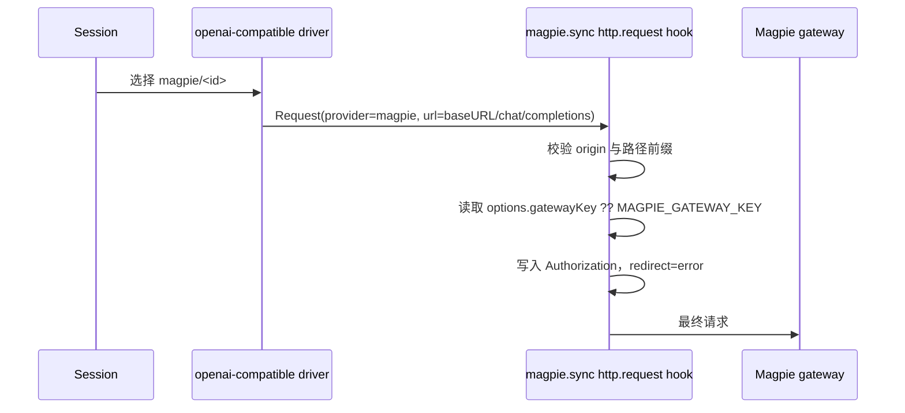
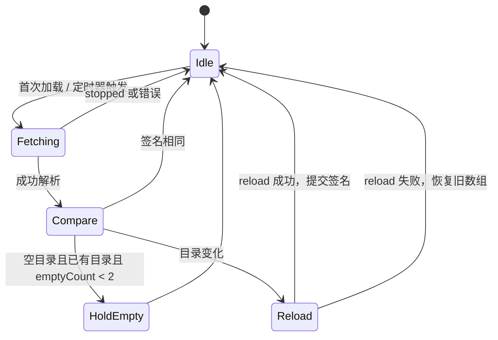

# 架构设计

共同分层、开发流程、文档职责与验证授权见 [统一工程规范](ENGINEERING.md)。项目专属规则见本文。

本文描述 `opencode-magpie-sync` 的模块边界、运行时数据流、鉴权链路与关键取舍。实现细节以 `src/` 为准；版本与兼容性策略见 [兼容性策略](COMPATIBILITY.md)。

## 1. 目标与非目标

### 设计目标

1. **目录即配置**：Magpie 侧增删模型后，OpenCode 无需改配置即可看到变化。
2. **原生体验**：使用 OpenCode 自己的 `/models` 选择器、provider 与 model 注册表，不引入独立 UI。
3. **失败可恢复**：网络抖动、网关重启、临时空目录不应破坏当前可用目录。
4. **密钥不外泄**：Gateway Key 不进入 provider 元数据、模型信息、错误信息或日志。
5. **边界清晰**：发现与推理都只访问配置的 origin 和路径前缀。
6. **可审计**：运行行为、验证边界和未覆盖项均有明确文档。

### 非目标

- 不实现 Magpie 服务端、模型路由或上游鉴权。
- 不提供工具调用、视觉、reasoning variant、价格、Responses API 等能力映射。
- 不实现多页目录分页；当前只读取一页 `/models`。
- 不提供跨重启的目录缓存或离线启动恢复。
- 不替代 OpenCode 的 provider 凭据体系（`/connect`、系统凭据库）。
- 不保证所有目录模型均可生成；可用性由 Magpie 与上游决定。

## 2. 包边界

```text
src/
  index.ts                 稳定导出：仅 default plugin
  core/
    catalog.ts             目录结构校验、显示标签、去重、排序、稳定签名
    gateway.ts             网关 URL 校验、有界 HTTP 发现
  server/
    plugin.ts              选项、Provider/Model 注册、鉴权钩子、轮询生命周期
```

| 模块 | 依赖 | 职责 | 不负责 |
| --- | --- | --- | --- |
| `core/catalog.ts` | 无宿主依赖 | 把不可信 JSON 转为受信任的 `MagpieModel[]` | 网络、注册、日志 |
| `core/gateway.ts` | `core/catalog.ts` | 解析 URL、发送带鉴权的有界发现请求 | 轮询、重试策略 |
| `server/plugin.ts` | `@opencode/plugin` | 把快照映射为原生 Provider/Model，管理钩子与定时器 | 目录解析细节 |

`core` 不导入 `@opencode/plugin`，可在普通 Node 环境中单测。`server` 只依赖 SDK 的公开类型与 `Plugin.define`，不访问 OpenCode 内部实现。

### 关于 SDK 依赖

`@opencode/plugin` 在 `dependencies` 中精确锁定为 **2.4.1**，用于类型检查与构建。宿主加载插件时通过其运行时模块机制提供自身 SDK 副本，因此：

- 本地 `node_modules` 的 SDK 版本必须与目标宿主匹配；
- 不能假定“类型通过”等于“宿主运行时兼容”；
- 升级宿主必须重新执行宿主冒烟与人工验收，见 [兼容性策略](COMPATIBILITY.md)。

包入口固定为编译后的 `dist/index.js`，`exports` 只暴露根入口。

## 3. 数据流

```mermaid
flowchart LR
  A[Magpie GET /models] -->|Bearer + timeout + 8 MiB cap| B[fetchCatalog]
  B --> C[parseCatalog]
  C --> D[筛选 type / 校验 ID / 去重]
  D --> E[排序 + 稳定签名]
  E -->|签名变化| F[source.models 快照]
  F --> G[ctx.provider.reload]
  G --> H[transform: editor.add]
  H --> I[OpenCode 原生模型注册表]
  I --> J[/models 选择器]
```

### 3.1 发现阶段

1. `modelCatalogURL(baseURL)` 校验协议为 `http`/`https`，拒绝内嵌凭据、查询串与片段，并保留路径前缀，拼出 `<baseURL>/models`。
2. `fetchCatalog` 使用 `Authorization: Bearer <key>`、`Accept: application/json`、`redirect: "error"` 与 `AbortSignal.timeout(timeoutMs)`。
3. 响应体上限 8 MiB：同时检查 `content-length` 与流式累计大小，超限立即失败。
4. JSON 解析失败、结构不符、重复 ID 或不安全 ID 均拒绝整个快照。
5. `parseCatalog` 仅保留 `type` 为 `chat`、`model` 或未提供的条目；其他字符串类型跳过。
6. 结果按 ID 排序，`catalogSignature` 序列化排序后的受信任结构。**顺序变化不触发 reload。**

### 3.2 注册阶段

`ctx.provider.transform` 在宿主构建 provider 注册表时执行：

```text
editor.get("magpie") 存在 → 抛出 Magpie provider collision
否则 editor.add({ info: provider, models: source.models })
```

`source.models` 是插件持有的可变数组。刷新时先替换数组内容，再调用 `ctx.provider.reload()`，宿主重新执行 transform 并读取新数组。

若 `reload()` 失败，插件恢复旧数组并抛出 `Magpie registry reload failed`，当前注册表保持上一版；下一次轮询会重试。

### 3.3 选择与推理

- 选择器显示 `magpie/<原始 ID>`。
- 请求体中的 `model` 字段保持原始 ID（例如 `trae-cn/Doubao-Seed-2.1-Turbo`）。
- 推理由宿主按 provider 的 `package`（`@opencode/ai/providers/openai-compatible`）选择驱动，使用 `settings.baseURL` 构造 OpenAI-compatible Chat 请求。

## 4. 鉴权链路

发现与推理使用同一凭据来源，但路径不同：

| 阶段 | 执行者 | 鉴权方式 |
| --- | --- | --- |
| 目录发现 | 插件内 `fetch` | 请求头直接写入 `Authorization: Bearer` |
| 模型推理 | 宿主 + 插件钩子 | `http.request` 钩子在最终请求上注入 Bearer |

推理钩子的处理顺序：



关键约束：

- 钩子通过 `{ providerID: "magpie" }` 作用域注册，仅处理本 provider。
- 钩子内部仍再次检查 `event.model.providerID`，作为纵深防御。
- 目标 URL 的 origin 必须等于 `baseURL` 的 origin，且 pathname 必须以 `baseURL + "/"` 开头；否则抛出 `Magpie request outside configured gateway`。
- 缺少密钥时抛出 `Magpie gateway key unavailable`，不发起匿名请求。
- 凭据只存在于插件闭包或 `process.env`，不写入 `Provider.Info`、`Model.Info` 或日志。

## 5. 刷新状态机



### 并发与关闭

- `pending` 保存进行中的刷新 Promise；重叠触发直接复用，不会并发发现。
- `stopped` 在卸载时置位。发现返回后若已停止，不提交快照。
- 卸载顺序：停止定时器 → 等待 `pending`（发现已有超时上限）→ 并行释放鉴权钩子与 provider 注册。释放失败只记录告警，不阻断另一步。
- 首次发现失败不阻止宿主启动；目录为空并持续重试。

### 空目录与错误语义

| 事件 | 行为 |
| --- | --- |
| 已有目录 + 第 1 次有效空响应 | 保留旧目录，`emptyCount = 1` |
| 已有目录 + 第 2 次连续有效空响应 | 提交空目录，触发 reload |
| 任意 HTTP/网络/超时/解析错误 | 保留旧目录，`emptyCount` 归零 |
| 非空目录 | `emptyCount` 归零 |
| 启动时目录为空 + 空响应 | 直接提交空目录（签名可能相同，reload 可省略） |

> 说明：空目录计数只统计**成功解析**的响应；失败不会推进清空流程。

## 6. 稳定标识与契约

| 标识 | 值 | 约束 |
| --- | --- | --- |
| 包名 | `opencode-magpie-sync` | 发布与安装路径稳定 |
| 插件 ID | `magpie.sync` | `Plugin.define` 固定 |
| Provider ID | `magpie` | 冲突时拒绝注册 |
| Provider 显示名 | `Magpie Gateway` | 用户可见 |
| 模型 ID | Magpie 原始 ID | 原样透传，含多级斜杠 |
| 选择引用 | `magpie/<ID>` | 由宿主拼接 |
| 插件版本 | `v0.1.0` | 未经维护者决定不变更 |

检测到已有 `magpie` provider 时抛出 collision，避免覆盖其他插件或手工配置。该检查发生在 transform 内，属于注册阶段的最后防线。

## 7. 设计取舍

| 决策 | 取舍 | 理由 |
| --- | --- | --- |
| 单一 provider，而非按分组建 provider | 失去分组级 provider 隔离 | 不建立分组级 provider，保持单一选择入口；完整 `magpie_label` 已保留分组信息，且模型 ID 不受显示名影响 |
| 目录仅驻留内存 | 重启后离线为空 | 避免落盘陈旧目录与潜在敏感信息；Magpie 是目录权威源 |
| 发现错误统一为通用消息 | 排障时看不到 HTTP 状态 | 防止任意 fetch 错误回显请求细节；需要精确定位时按 [故障排查](TROUBLESHOOTING.md) 在本机受控验证 |
| 限额缺失写 `0` | 宿主对 `0` 的解释需实测 | 保持“未提供数据”的显式数值约定，不猜测上游能力；已列入 [验证范围](VALIDATION.md) |
| 工具固定关闭 | 目录模型即使支持工具也不可用 | 上游工具调用兼容性未验证，保守声明避免错误调用 |
| 只读一页 `/models` | 多页目录会不完整 | 当前 Magpie 部署单页返回完整目录；分页需要上游游标契约 |
| 无独立 TUI 插件 | 选择器刷新依赖宿主传播 | 保持服务端最小面；宿主 reload 与 TUI 缓存传播是两个环节 |
| 不自动探测地址 | 配置错误时目录为空 | 避免把凭据发送到非预期端点 |

## 8. 已知限制

1. **无分页**：忽略 `has_more`/游标；服务端必须先返回完整目录。
2. **协议单一**：仅 OpenAI-compatible Chat；不使用 `native_endpoints` 切换协议。
3. **能力保守**：工具、视觉、reasoning、价格、缓存等字段未映射。
4. **限额未知**：缺失值写 `0`，宿主的输出与压缩行为未验证。
5. **传播延迟**：`Catalog synced` 只证明服务端注册表已提交，不证明 TUI 已刷新。
6. **无持久化**：进程重启即冷启动；离线时没有上一进程目录。
7. **单实例语义**：同一宿主只允许一个 `magpie` 注册来源。
8. **日志可观测性有限**：发现失败默认不暴露 HTTP 状态；需要结合本机诊断。

## 9. 扩展点

| 需求 | 建议改动位置 | 注意事项 |
| --- | --- | --- |
| 映射更多 Magpie 字段 | `core/catalog.ts` + `server/plugin.ts:toModel` | 同步更新签名，避免仅顺序变化触发 reload |
| 支持分页 | `core/gateway.ts` + 目录快照结构 | 需要明确游标、上限与去重语义 |
| 按分组拆分 provider | `server/plugin.ts` | 会改变稳定 ID 与选择体验，需版本化迁移 |
| 增加指标/健康端点 | `server/plugin.ts` | 不得输出密钥或完整目录 |
| 独立 TUI 刷新 | 新增 TUI 入口 | 当前包只有 Server 入口，需评估宿主 TUI 契约 |

任何扩展都必须保持：`core` 无宿主依赖、错误不泄露敏感数据、默认验收不发送生成请求。
